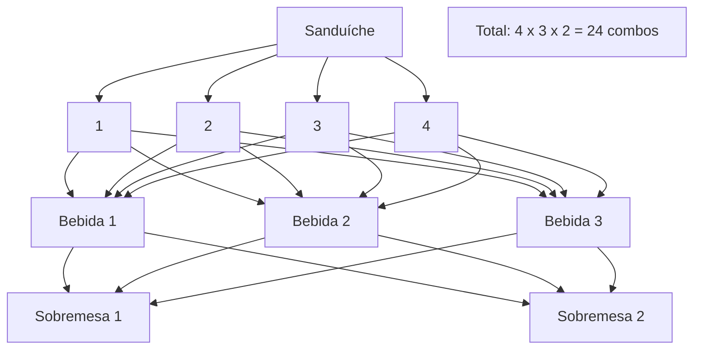
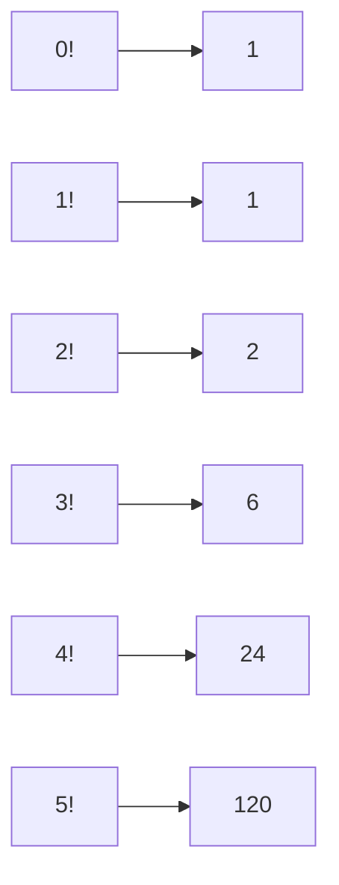
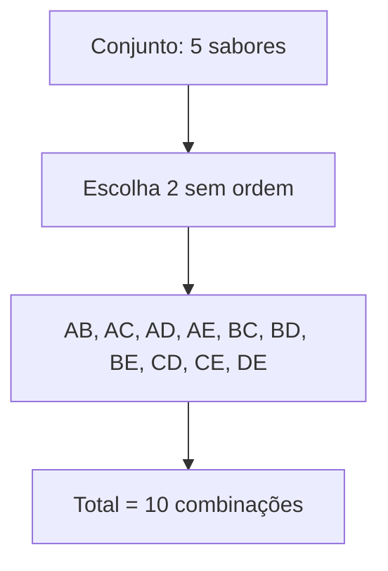

# Encontro 2026/10/21 - Estatística

## Revisão - Analise Combinatória

### Princípio Fundamental da Contagem

Quantos combos podem ser formados em uma lanchonete que oferece: 4 tipos de sanduíche, 3 tipos de bebidas e 2 tipos de sobremesa?

Resposta: 4 x 3 x 2 = 24 combinações.

### Fatorial

O fatorial de um número natural n é o produto de todos os inteiros positivos até n.

- 0! = 1
- 1! = 1
- 2! = 2 x 1 = 2
- 3! = 3 x 2 x 1 = 6
- 4! = 4 x 3 x 2 x 1 = 24
- 5! = 5 x 4 x 3 x 2 x 1 = 120

### Combinação (ordem não importa)

A combinação representa o número de grupos que podemos formar escolhendo k elementos de um conjunto de n elementos, sem considerar a ordem.

Fórmula:

C(n, k) = n! / (k! (n - k)!)

Exemplo:

Escolher 2 sabores de pizza entre 5 disponíveis:

C(5, 2) = 5! / (2! 3!) = 10

### Arranjo (ordem importa)

O arranjo representa o número de sequências que podemos formar ao escolher k elementos de um conjunto de n elementos, considerando a ordem da escolha.

Fórmula:

A(n, k) = n! / (n - k)!

Exemplo:

Quantas senhas com 3 dígitos distintos podem ser formadas usando os algarismos 1, 2, 3, 4?

A(4, 3) = 4! / (4 - 3)! = 4 x 3 x 2 = 24

Ou seja, a ordem dos dígitos altera a senha, então 123 e 321 são arranjos diferentes.

### Resumo

- Princípio Fundamental da Contagem: multiplica as opções
- Fatorial: produto dos números até n
- Combinação: escolhe grupos sem considerar ordem
- Arranjo: escolhe sequências considerando a ordem
